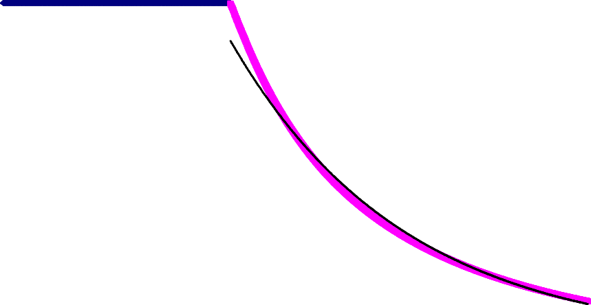
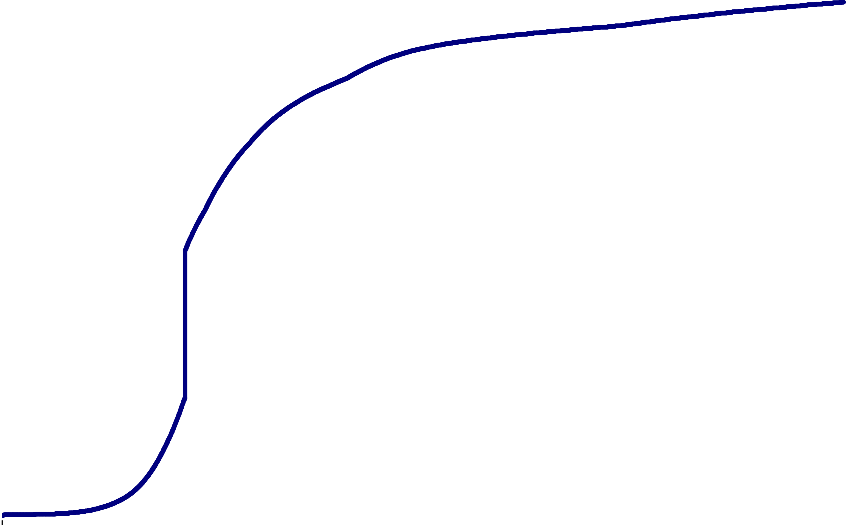
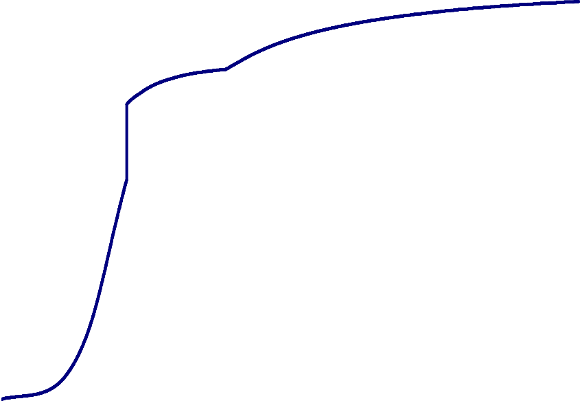
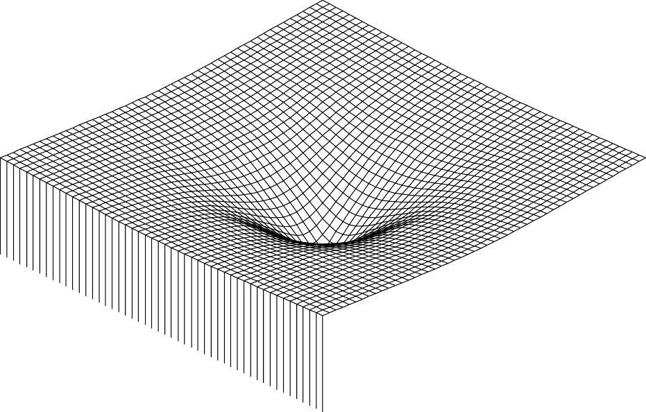
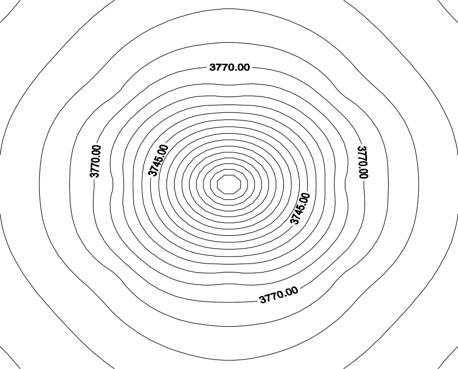
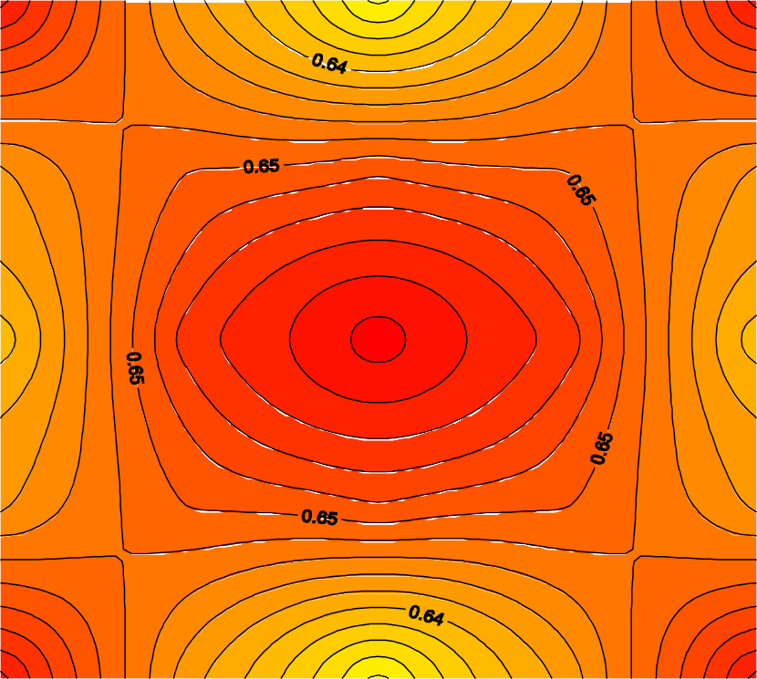
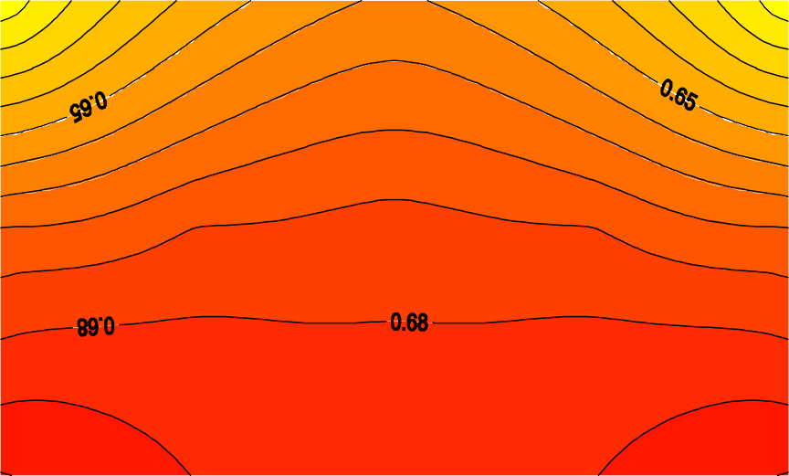

# Chapter 6: KUSIM Applications

> Transcribed from `legacy/thesis/Chapeter VI-KUSIM Applications.docx` / `.pdf`. The charts in the
> original were vector drawings whose axes and labels are text, so the extracted images below show
> the curves without axes. Axis ranges and values taken from the text are given in each caption.
> Figures that I identified by order in the document (6.1-6.4 curves) are marked "(identified by order)".
> Items marked **[Note]** are transcription remarks that matter for the Python port.

## Application 1: three-dimensional waterflood test case

A reservoir model has the following data (INPUT DATA). This is essentially the case in
`legacy/fortran-3d3/INPUT.DAT` (I checked the grid, permeability, porosity, datum, PVT and saturation tables,
which match), with the differences listed in the notes below: the time step and end time, the oil rate,
the injector settings, and `MOPR`.

### System data, boundary and initial conditions

| Item | Value |
|---|---|
| `NX`, `NY`, `NZ` | 5, 5, 3 (75 blocks) |
| `DX(I)` | 100, 75, 50, 75, 100 ft |
| `DY(I)` | 100, 75, 50, 75, 100 ft |
| `DZ(I)` | 20, 30, 40 ft (layers 1, 2, 3) |
| `KX(I)` | 375 md in every block |
| `KY(I)` | 375 md in every block |
| `KZ(I)` | 100 md in every block |
| `PHI(I)` | 0.20 in every block |
| `RDATUM` (reference datum) | 5000 ft |
| `WOCD` (WOC, distance from datum) | 250 ft |
| `DPRESS` (datum pressure) | 4800 psi |
| `DH(I)` (mid-point height difference to datum) | per column of 25 cells, repeated per layer, see below |
| `GAMAO` | 0.85 |
| `GAMAW` | 1.0 |
| `SWI` | 0.2 |
| `SWC` | 0.2 |
| `SOR` | 0.2 |
| `CR` (rock compressibility) | 0.00045 |
| `DT` | 0.25 |
| `TMAX` | 1000 |

`DH(I)` as printed: the pattern `10.0 5.0 0.0 5.0 10.0` repeated six times (30 values), wrapped across lines.

> **[Note]** The FORTRAN reads only `W = NX*NY` = 25 values of `DH` (`READ (13,*) (DH(I),I=1,W)`), so the last
> five of the 30 printed values are ignored (they repeat the same pattern, so nothing changes). One layer's
> worth of `DH` is used for all layers. Check how the code adds the layer offsets
> (the `DO 602 O=0,NZ-1` loop near line 179 of `3DTP(11).FOR`).

> **[Note]** The chapter lists a `SWI = 0.2` line before `SWC`; the FORTRAN has no `SWI` read
> (`GAMAO`, `GAMAW`, `SWC`, `SOR`, `CR`, `DT`, `TMAX`) and the baseline `INPUT.DAT` has none either.
> **`DT` and `TMAX` differ from the baseline file:** the chapter has `DT = 0.25`, `TMAX = 1000`, while
> `INPUT.DAT` has `DT = 1`, `TMAX = 5000`. The time unit is not stated in the chapter, but the
> "after 1000 days" results below imply days. The shipped `*.OUT` files probably come from the
> baseline file's settings, not the chapter's, so they may not be comparable to the chapter's figures.
> Check the row count of `PO.OUT` against `TMAX/DT` before using them as a baseline.

### PVT table (`NPVT = 4`)

| P (psi) | Bo (rb/stb) | Bw (rb/stb) | µo (cp) | µw (cp) |
|---|---|---|---|---|
| 1500 | 1.522 | 1.0044 | 0.45 | 0.95 |
| 2000 | 1.500 | 1.0000 | 0.50 | 1.00 |
| 3500 | 1.478 | 0.9956 | 0.55 | 1.05 |
| 4300 | 1.450 | 0.9911 | 0.75 | 1.07 |

> **[Note]** `legacy/fortran-3d3/PVT.DAT` has only 3 rows (to 3500 psi), but the PVT table inside
> `INPUT.DAT` has all 4 rows, identical to this one. The FORTRAN reads the PVT table from `INPUT.DAT`
> (lines 84-92), so `PVT.DAT` is not used by this version.

### Saturation vs. relative permeability table (`NSAT = 23`, `PCMULT = 1.0`)

(The chapter prints this header as "231.0 NSAT,PCMULT", i.e. `23` and `1.0` run together.)

| Sw | kro | krw | Pcow (psi) |
|---|---|---|---|
| 0.000 | 0.800 | 0.000 | 68.0 |
| 0.040 | 0.800 | 0.000 | 68.0 |
| 0.080 | 0.800 | 0.000 | 68.0 |
| 0.120 | 0.800 | 0.000 | 68.0 |
| 0.160 | 0.800 | 0.000 | 50.0 |
| 0.200 | 0.650 | 0.002 | 32.0 |
| 0.240 | 0.513 | 0.010 | 21.0 |
| 0.280 | 0.400 | 0.020 | 15.5 |
| 0.320 | 0.315 | 0.033 | 12.0 |
| 0.360 | 0.250 | 0.049 | 9.20 |
| 0.400 | 0.196 | 0.066 | 7.00 |
| 0.440 | 0.150 | 0.090 | 5.30 |
| 0.480 | 0.112 | 0.119 | 4.20 |
| 0.520 | 0.082 | 0.150 | 3.40 |
| 0.560 | 0.060 | 0.186 | 2.70 |
| 0.600 | 0.040 | 0.227 | 2.10 |
| 0.640 | 0.024 | 0.277 | 1.70 |
| 0.680 | 0.012 | 0.330 | 1.30 |
| 0.720 | 0.005 | 0.390 | 1.00 |
| 0.760 | 0.000 | 0.462 | 0.70 |
| 0.800 | 0.000 | 0.540 | 0.50 |
| 0.840 | 0.000 | 0.620 | 0.40 |
| 1.000 | 0.000 | 1.000 | 0.00 |

### Production wells (`NOPWS = 1`)

| Item | Values as printed |
|---|---|
| `PWL(I)` location (block number) | 13, 2, 24 |
| `PRW(I)` wellbore radius (ft) | 0.25, 0.3, 0.2 |
| `PS(I)` skin factor | 0.5, +0.2, 0.3, 0.3 |
| `MPBHP(I)` minimum BHP (psi) | 2500, 30, 31 |
| `PBC` production boundary condition | 1 |
| `QO(I)` constant oil rate (`PBC=1`) | 2500, 2000, 1500, 10 |
| `QL(I)` constant liquid rate (`PBC=2`) | 600, 400, 490, 490 |
| `PBHP(I)` constant BHP (`PBC=3`) | 3000, 700, 1016, 1340 |

With `NOPWS = 1`, only the first entry of each list is used: one producer at block 13, radius 0.25 ft,
skin 0.5, constant oil rate 2500 bbl/day with a minimum BHP of 2500 psi (see the description below).

Block 13 is the centre of layer 1 ($i=3$, $j=3$, $k=1$ on the 5x5 grid).

> **[Note]** The `MOPR(I)` (minimum oil production rate) line that `3DTP(11).FOR` reads after `MPBHP`
> (line 104) is missing from the chapter listing. `INPUT.DAT` has `100 110 120  MOPR(I)`.
> The listed `MPBHP` value of 2500 equals the listed `QO` of 2500; the text below reads this as the
> production rate (2500 bbl/day) being specified together with a minimum BHP. Check the intended values
> against the baseline `INPUT.DAT` (which has `QO = 5000 ...`, not 2500).

### Injection wells

| Item | Values as printed |
|---|---|
| `NOIWS` | *(value not printed)* |
| `IWL(I)` location | 51, 55, 71, 75 |
| `IRW(I)` wellbore radius (ft) | 0.3, 0.3, 0.3, 0.3 |
| `IS(I)` skin factor | 0.5, -0.2, 0.3, 0.3 |
| `IBC` injection boundary condition | *(value not printed)* |
| `QW(I)` constant injection rate (`IBC=1`, bbl/day) | 1000, 1000, 1000, 1000 |
| `IBHP(I)` constant BHP (`IBC=2`, psi) | 5000, 4000, 4200, 5100 |

> **[Note]** The numbers for `NOIWS` and `IBC` are lost in the Word conversion. The baseline
> `INPUT.DAT` has `NOIWS = 0`, `IBC = 1`, i.e. **no injection wells**. Whether the chapter's run used
> injectors is not stated; the PDF may show it. Check the PDF page. Blocks 51-75 are the bottom layer
> (layer 3) of the 5x5x3 grid.

### Production boundary-condition codes

From the section headers in the listing:

- `PBC = 1`: constant oil production rate (`QO`)
- `PBC = 2`: constant liquid production rate (`QL`)
- `PBC = 3`: constant bottom-hole pressure (`PBHP`)
- `IBC = 1`: constant injection rate (`QW`)
- `IBC = 2`: constant injection bottom-hole pressure (`IBHP`)

### Results

**Production rate.** A constant oil production rate of 2500 bbl/day is specified, together with a
minimum bottom-hole pressure. When the bottom-hole pressure reaches the specified minimum, the
condition changes to a constant bottom-hole pressure boundary condition.

*Figure 6.1: Oil production rate vs. time (identified by order). x: time, 0 to 3 years; y: production rate
(bbl/day), 0 to 3000. The rate is flat at 2500 bbl/day, then declines once the minimum BHP is reached.
The thin black line is the exponential trend line below.*

The decline curve analysis shows that the production rate declines exponentially. The trend line
(black curve in the figure) can be described by:

$$q_o = 8235.5\,e^{-1.2284\,t}$$

where $t$ is in years (the figure's time axis).

**Cumulative production.**

*Figure 6.2: Cumulative oil production vs. time (identified by order). x: time, 0 to 3 years;
y: cumulative oil, 0 to 7,000,000 (the original axis is labelled "bbl/day", which is a units typo
for bbl).*

**Water production.**

*Figure 6.3: Water production rate vs. time (identified by order). x: time, 0 to 3 years;
y: water production (bbl/day), 0 to 16,000.*

**Water cut.**

*Figure 6.4: Water cut vs. time (identified by order). x: time, 0 to 3 years; y: water cut, 0 to 1.*

**Pressure profile for the upper layer (after 1000 days).**

*Figure 6.5: Layer 1 pressure profile. A 3-D surface of pressure over the 5x5 plan, with a cone of
depression centred on the producer.*

**Isobaric lines.**

*Figure 6.6: Layer 1 isobaric contour lines. Plan axes 1.00 to 5.00 in $x$ and $y$. Labelled
contours include 3745 and 3770 psi, forming concentric rings around the well.*

**Equal-saturation contour lines.**

*Figure 6.7a: Layer 1 equal-saturation contour lines (plan view). Plan axes 1.00 to 5.00. Labelled
contours around 0.64-0.65, with a maximum at the centre.*

**Cross-sectional saturation profile (Y-Z).**

*Figure 6.7b: Equal-saturation contour lines (x-sectional view). Axes 1.00 to 5.00 horizontally and
layers vertically. Labelled contours include 0.65 and 0.68, increasing with depth.*

### Pressure buildup test

The production rate was constant (2500 bbl/day) for 120 days. The well (block 13) was then shut in for
3 days, and the static bottom-hole pressure was calculated during the shut-in period.

*Figure 6.8: Typical pressure buildup curve.* A Horner-type plot. x: $\log\left((t+\Delta t)/\Delta t\right)$,
from 1 to 100 (log scale); y: static bottom-hole pressure, 4420 to 4465 psi. (The curve itself did not
survive the conversion as an image. The raw plot data are not in the document.)

> **[Note]** Reproducing this test is a possible exercise for the port: run 120 days at constant rate,
> then set the rate to zero for 3 days and record the BHP at block 13. The buildup pressures (4420-4465 psi)
> are higher than the contour labels in Fig. 6.6 (3745-3770 psi); Fig. 6.6 is at 1000 days and this
> test is at 120-123 days, but I haven't verified that this explains the difference.

## Application 2: Buckley-Leverett displacement mechanism

To study the effect of displacement by water clearly, a one-dimensional model with an injection well
at one side and a production well at the other is used.

| Property | Value |
|---|---|
| Oil FVF, $B_o$ | 1.5 bbl/STB |
| Water FVF, $B_w$ | 1.02 bbl/STB |
| Thickness, $h$ | 20 ft |
| Cross-sectional area, $A$ | 26,400 ft² |
| Porosity, $\phi$ | 25 % |
| Injection rate, $i_w$ | 900 bbl/day |
| Production rate | 600 bbl/day |
| Distance between producer and injector, $L$ | 600 ft |
| Dip angle, $\alpha$ | 0° |
| Initial water saturation, $S_{wi}$ | 20 % |
| Residual oil saturation, $S_{or}$ | 20 % |
| Oil viscosity, $\mu_o$ | 2.0 cp |
| Water viscosity, $\mu_w$ | 1.0 cp |
| Initial pressure | 3500 psi |
| Absolute permeability | 350 md |

> **[Note]** The injection rate (900 bbl/day) and production rate (600 bbl/day) are printed as different
> values. For an incompressible displacement they would normally match. Confirm which rates the run
> used before comparing with the analytical Buckley-Leverett solution.

**Geometry.** A (10-1-1) system, i.e. 10 blocks in the x direction, each 60 ft long:

| Item | Value |
|---|---|
| `NX`, `NY`, `NZ` | 10, 1, 1 |
| `DX(I)` | 60 ft for each of the 10 blocks (600 ft total) |
| `DY(I)` | 1320 ft |
| `DZ(I)` | 20 ft |
| Time step | 0.25 day |

(Check: $A = DY \times DZ = 1320 \times 20 = 26{,}400\ \text{ft}^2$, matching the cross-sectional area above.)

**Result.** The run was carried out and the water saturation of each block after 60, 120 and 240 days
was plotted against distance from the injector $x$. The plot is in good agreement with the Buckley-Leverett
theorem.

*Figure 6.9: Saturation profile.* x: distance from injector, 0 to 600 ft; y: water saturation, 0 to 1;
three curves, $S_w$ at 60, 120 and 240 days. (The three curves were vector drawings and are not
reproduced here.)

> **[Note]** The relative-permeability table for this 1-D case is not printed in the chapter. It is needed
> to compute the analytical Buckley-Leverett fractional-flow curve for comparison (see `BL2.xls`
> in `legacy/fortran-3d3/`, which likely holds that comparison).

## Using these applications as test cases for the port

| Case | Source of inputs | What to compare |
|---|---|---|
| Application 1 (3-D, 5x5x3) | `legacy/fortran-3d3/INPUT.DAT` with the chapter's `DT`, `TMAX`, `QO`, `MOPR` etc. (differences noted above) | Figs. 6.1-6.4 shape, trend line $8235.5e^{-1.2284t}$, Figs. 6.5-6.7 qualitative contours; the shipped `*.OUT` files only if their time settings match |
| Pressure buildup | Application 1 with 120 days at 2500 bbl/day then 3 days shut in | Horner plot range 4420-4465 psi |
| Application 2 (1-D, 10x1x1) | Table above (needs a relative-permeability table) | Water saturation after 60, 120, 240 days vs. Buckley-Leverett |
